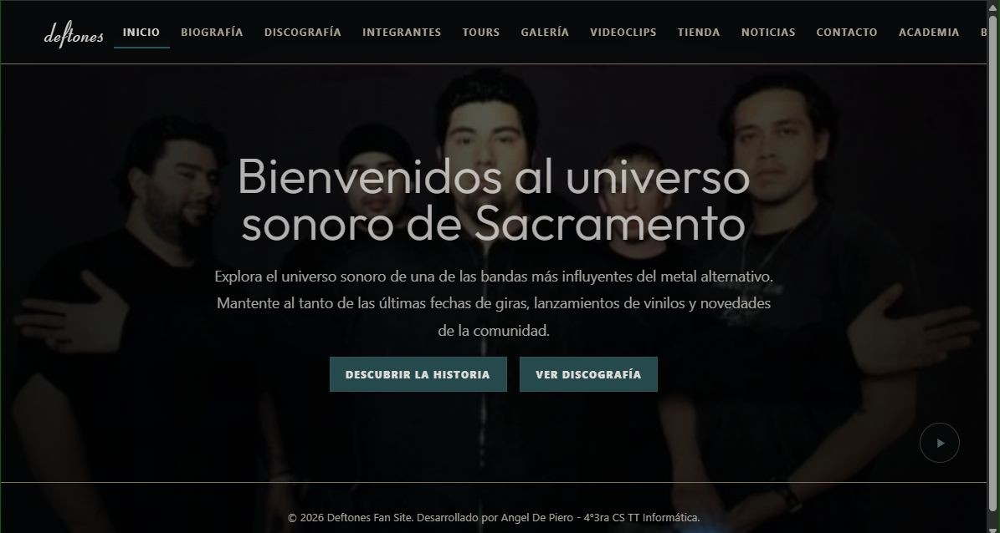
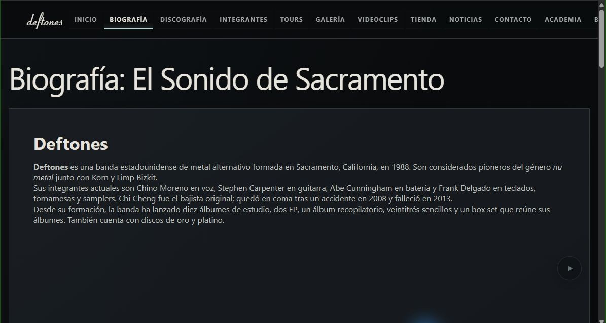
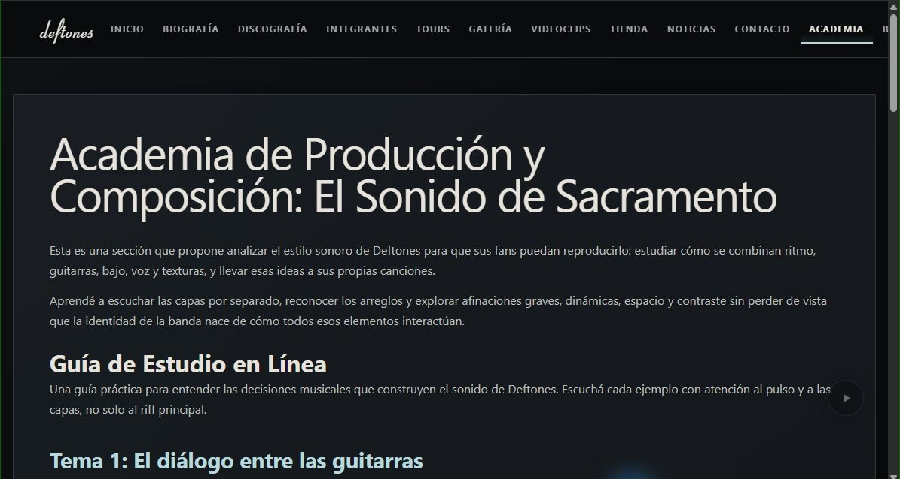
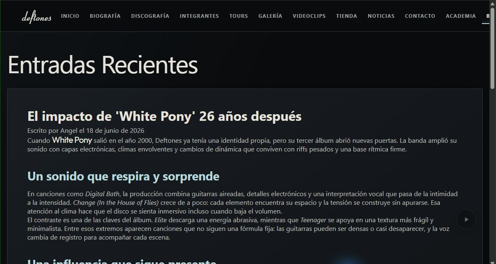
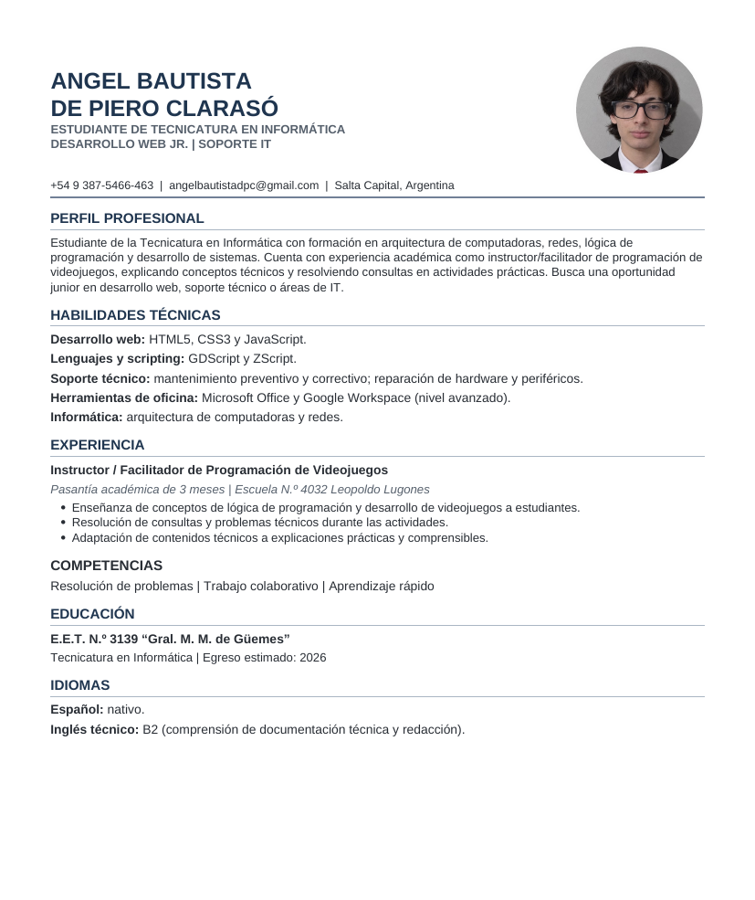
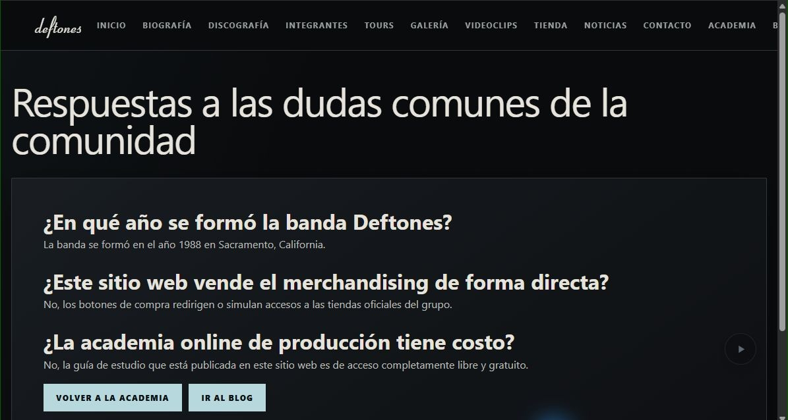
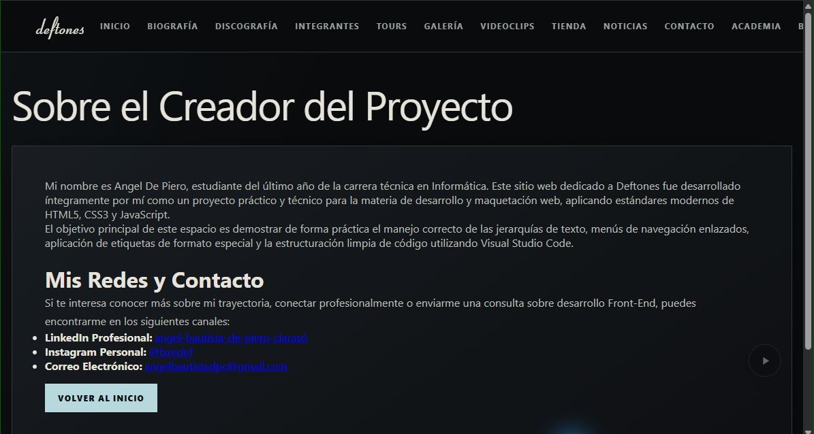

# Trabajo práctico del 12 de junio
## Deftones: encabezados, curso, blog y currículum

**Autor:** Angel De Piero  
**Curso:** 4°3ra CS TT Informática

Este informe reúne ejemplos del sitio y explica cómo se resolvieron las consignas del trabajo práctico. Las capturas muestran páginas del proyecto; los fragmentos de código ilustran las etiquetas y la estructura usadas.

## 1. Encabezados en las diez páginas

En las diez páginas principales se organizó el contenido con encabezados jerárquicos. El encabezado común (`h1`) identifica el sitio y la navegación; cada página presenta su tema con `h2`, y los apartados usan `h3` y niveles inferiores cuando hace falta. Así se mantiene una estructura reconocible sin convertir los encabezados en texto decorativo.

Las diez páginas consideradas son Inicio, Biografía, Discografía, Integrantes, Tours, Galería, Videoclips, Tienda, Noticias y Contacto.

### Ejemplos visuales

| Inicio | Biografía |
|---|---|
|  |  |

La misma barra de navegación y jerarquía de títulos se repite en el resto de las secciones.

## 2. Curso y guía de estudio en línea

La sección **Academia** ofrece una guía para analizar y estudiar el sonido de Deftones. Organicé los temas principales, subtemas y explicaciones con distintos niveles de encabezado. El contenido recorre la relación entre guitarras, voces, batería, bajo y capas electrónicas.



La estructura se encuentra en `html/curso.html`. Los encabezados permiten identificar cada tema antes de leer sus detalles.

## 3. Blog y comentarios

En `html/blog.html`, `h2` presenta la página; `h3` identifica la entrada principal y el blog personal; los encabezados `h4` organizan partes del artículo y las áreas de comentarios. Esta jerarquía separa el contenido editorial de la participación de la comunidad.

El blog incluye registro e inicio de sesión, lectura pública de comentarios y entradas, y formularios para participar. Las publicaciones se presentan con su título, autor, fecha y texto.



## 4. Currículum Vitae

El currículum se incorporó en **Quiénes somos**, debajo de la presentación del estudiante y de las tecnologías usadas para el proyecto. El PDF original se conserva en `docs/cv/`; la página lo muestra dentro de un recuadro y ofrece enlaces para abrirlo o descargarlo.



### Cómo se integró

- Copié el PDF al directorio `docs/cv/` para que quede junto al proyecto.
- Usé un `iframe` con título accesible para mostrar el documento dentro de la página.
- Añadí alternativas para abrirlo en otra pestaña o descargarlo.
- Apliqué estilos al recuadro para que se integre con el diseño y se adapte a pantallas angostas.

La presentación principal ya existente se mantiene arriba del panel del currículum.

## 5. Etiquetas `p`, `br` y `pre`

La etiqueta `p` se usa en los textos del sitio para separar párrafos. En el panel nuevo del CV, `br` separa dos líneas informativas y `pre` conserva los saltos y la sangría de un ejemplo de HTML:

```html
<p>
  Sitio desarrollado con HTML5, CSS3, JavaScript y PHP.<br>
  El documento se puede consultar o descargar.
</p>

<pre><code>&lt;main&gt;
  &lt;h2&gt;Sobre el creador&lt;/h2&gt;
  &lt;p&gt;Presentación del proyecto.&lt;/p&gt;
  &lt;section&gt;Currículum Vitae&lt;/section&gt;
&lt;/main&gt;</code></pre>
```

El bloque `pre` se limita a mostrar el ejemplo tal como está escrito, mientras que `code` identifica que el contenido es código.

## 6. Preguntas frecuentes y Quiénes somos

La página **Preguntas frecuentes** organiza cada consulta como encabezado y su respuesta como párrafo. **Quiénes somos** presenta al autor y el propósito del proyecto; debajo se incorporó el recuadro del currículum solicitado.

| Preguntas frecuentes | Quiénes somos |
|---|---|
|  |  |

El PDF completo también se muestra en el visor añadido debajo de la presentación.

## 7. Pie de página

Las páginas del sitio cierran con un pie que separa el contenido del crédito mediante `hr`. El párrafo incluye el año, el nombre del sitio y la atribución del proyecto. El mismo patrón se conserva en las secciones:

```html
<footer>
  <hr>
  <p>&copy; 2026 Deftones Fan Site. Desarrollado por Angel De Piero.</p>
</footer>
```

## Archivos principales

- `html/curso.html`: guía del curso en línea.
- `html/blog.html`: entrada, comentarios y blog de la comunidad.
- `html/faq.html`: preguntas frecuentes.
- `html/nosotros.html`: presentación y visor del CV.
- `css/style.css`: estilos del panel y del visor del currículum.
- `docs/cv/`: PDF original y vista previa.
- `docs/capturas/`: capturas de ejemplo de las secciones.

---
**Trabajo práctico de desarrollo web — 12 de junio**  
**Angel De Piero · 4°3ra CS TT Informática**
