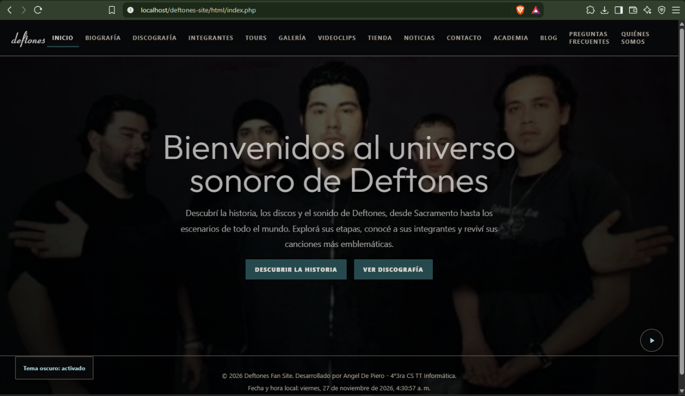
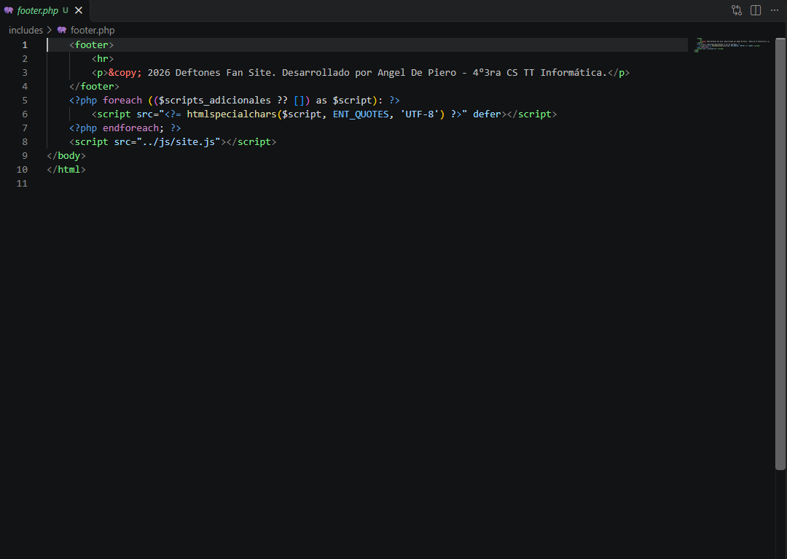
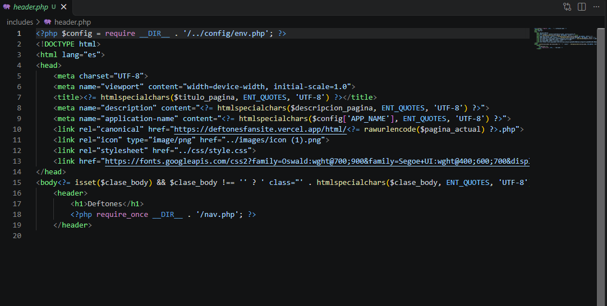
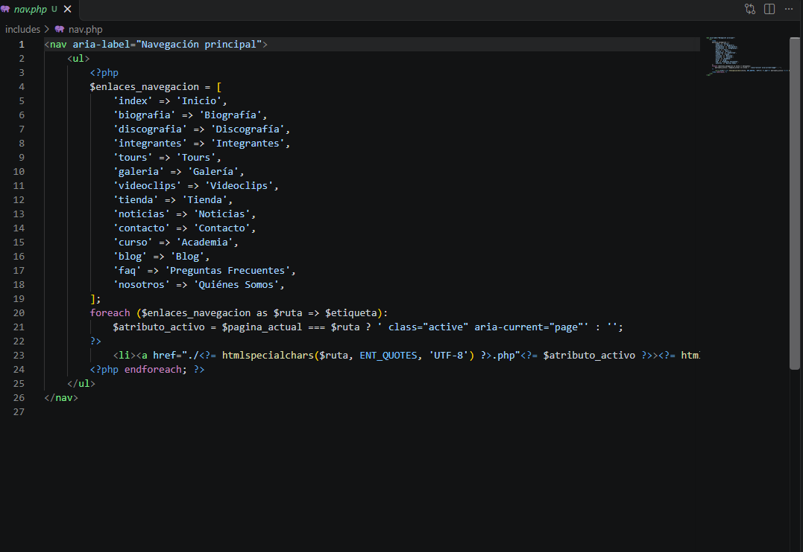
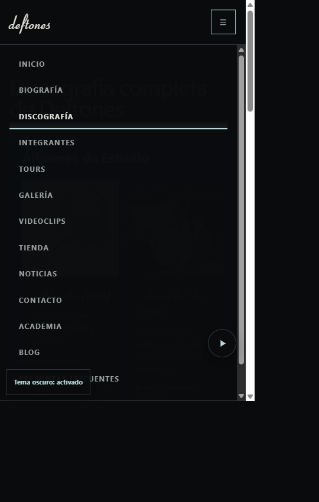
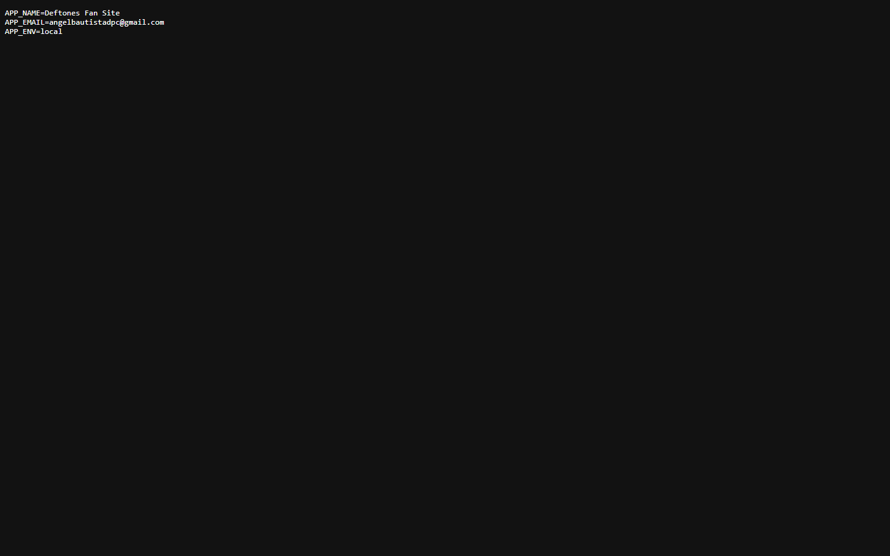

# Trabajo práctico: migración a PHP, modularización y SSR

**Autor:** Angel De Piero  
**Curso:** 4°3ra CS TT Informática  
**Proyecto:** Deftones Fan Site

## Descripción

Yo tomé el sitio que había desarrollado con HTML, CSS y JavaScript y migré sus páginas a PHP para ejecutarlas en un servidor local. También separé el encabezado, el menú y el pie de página en plantillas reutilizables. Así, cuando modifico una de esas partes, puedo hacerlo en un solo archivo en vez de repetir el cambio en cada pantalla.

Yo mantuve el contenido y el diseño del sitio, y agregué títulos dinámicos, una opción activa en el menú según la página y variables para la configuración local.

## Prototipo de Figma

Yo comparto el prototipo del sitio en [Figma](https://www.figma.com/proto/lDl8NHTJ41YZ2SRrrDBtwG/Sin-t%C3%ADtulo?node-id=0-1&t=0SoaMP6MJ3joY78W-1).

## Tecnologías que utilicé

- HTML5 para la estructura y el contenido de cada página.
- CSS3 para la presentación común y el diseño adaptable.
- JavaScript para las interacciones del sitio.
- PHP 8 para generar las páginas en el servidor e incluir las plantillas.
- Apache y XAMPP para ejecutar el proyecto localmente.
- Git y GitHub para registrar y compartir los cambios.

Yo no utilicé MySQL ni phpMyAdmin en este trabajo porque la consigna no requiere una base de datos.

## Cómo ejecutar el sitio con XAMPP

1. Yo instalé XAMPP y coloqué la carpeta del proyecto dentro de `C:\xampp\htdocs\deftones-site`.
2. Si todavía no existe `.env`, yo copio `.env.example` y nombro la copia `.env` en la carpeta principal.
3. Abro el **XAMPP Control Panel** y presiono **Start** junto a **Apache**. No necesito iniciar MySQL.
4. Abro `http://localhost/deftones-site/` en el navegador.

Yo no abro los archivos PHP con doble clic: para que PHP los procese, visito el sitio desde `localhost`.

## Evidencias

### Sitio ejecutándose en el servidor local

La captura muestra el sitio abierto desde `localhost` y el enlace de Inicio activo.

### Modularización SSI

Yo guardé el encabezado y la apertura del documento en `includes/header.php`, el menú en `includes/nav.php` y el pie con los scripts en `includes/footer.php`. Cada página de `html/` los incorpora mediante `require_once`.

**Pie de página y carga de scripts:**

**Encabezado y metadatos:**

**Menú compartido:**

### Título dinámico y navegación activa

Yo defino `$titulo_pagina` y `$pagina_actual` en cada página PHP. El encabezado usa el título correspondiente y el menú agrega `class="active"` y `aria-current="page"` al enlace de la sección actual. Por ejemplo, al entrar a Discografía, el título generado es **Discografía de Deftones: álbumes y canciones** y el enlace de Discografía queda activo.

### Variables de configuración

Yo guardo el nombre del sitio, el correo de contacto y el entorno en `.env`. Git ignora ese archivo local. En cambio, subo `.env.example` como plantilla para indicar qué variables hacen falta.

## Qué implementé

### Migración de HTML a PHP

Yo cambié las 14 páginas de `html/` a archivos `.php` y actualicé los enlaces internos. También convertí la página de entrada de la raíz en `index.php`, que dirige a la portada del sitio.

### Inclusiones SSI y renderizado del lado del servidor

Yo creé estos archivos compartidos:

- `includes/header.php`: metadatos, hoja de estilos, nombre de la aplicación e inicio del encabezado.
- `includes/nav.php`: enlaces internos y estado activo de la página actual.
- `includes/footer.php`: pie de página y scripts compartidos.
- `config/env.php`: lectura y validación de los valores locales de `.env`.

Cada página define antes de incluir la plantilla sus variables `$titulo_pagina`, `$descripcion_pagina` y `$pagina_actual`. PHP combina esos datos con las plantillas y envía el HTML generado al navegador; a eso se refiere el renderizado del lado del servidor.

### Configuración y cuidado de datos

Yo agregué `.env` a `.gitignore` para no subir la configuración local. Dejé `.env.example` en el repositorio como modelo. En esta versión, las variables son `APP_NAME`, `APP_EMAIL` y `APP_ENV`; no guardo contraseñas ni claves secretas en ellas.

## Comprobaciones

Yo comprobé que las páginas PHP se puedan interpretar, que cada una muestre su título y que el enlace activo corresponda a la sección navegada. También revisé que Git ignore `.env` y permita incluir `.env.example`.

## Estado de entrega

Yo desarrollé estos cambios en la rama `feature/migracion-php-ssi`. La integración mediante Pull Request queda pendiente.
