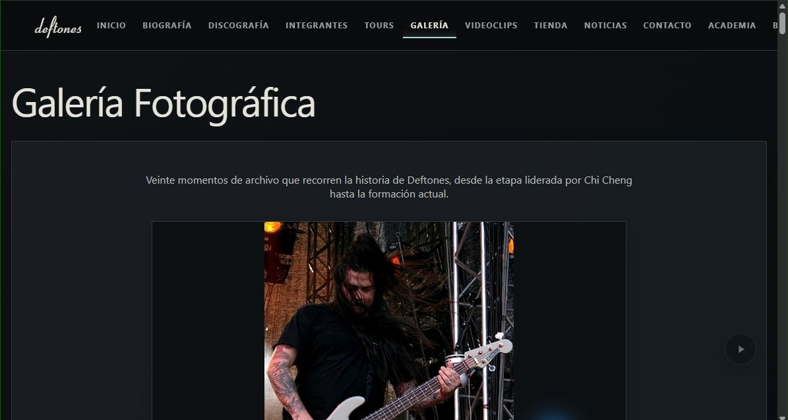
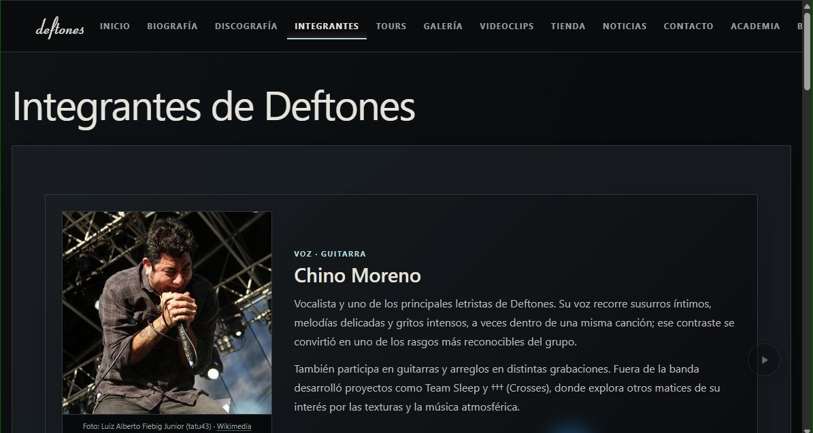
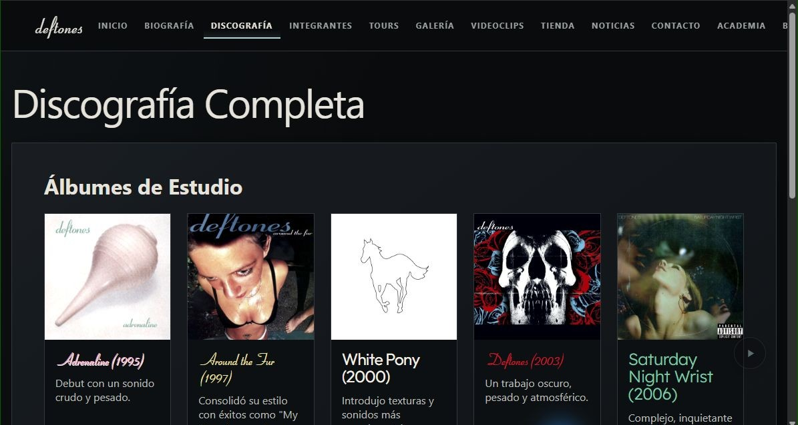

# Trabajo práctico del 26 de junio
## Imágenes y enlaces en el sitio

**Autor:** Angel De Piero  
**Curso:** 4°3ra CS TT Informática

En este trabajo explico cómo agregué imágenes locales al sitio y cómo vinculé cada portada de álbum con su página correspondiente en Spotify. Los ejemplos se toman de las secciones Discografía, Galería e Integrantes.

## 1. Organizar y agregar imágenes

Guardé las imágenes del proyecto en la carpeta `images/`. Como las páginas HTML están dentro de `html/`, las rutas relativas suben un nivel y después entran a `images/`:

```html

```

- `src` indica la ubicación del archivo.
- `../images/` parte desde la carpeta `html/` y llega a la carpeta de recursos.
- `alt` describe la imagen para lectores de pantalla y aparece si el archivo no carga.

En la Galería se usa la misma idea para cada foto, con un texto alternativo que describe a la persona o el momento fotografiado.



Las portadas de Discografía y los retratos de Integrantes también se cargan desde archivos locales:



## 2. Ajustar cómo se muestran

En `css/style.css` definí reglas para que las imágenes se adapten al tamaño de sus tarjetas. Por ejemplo, las portadas mantienen una proporción cuadrada y llenan el área sin deformarse:

```css
.album-card img {
    width: 100%;
    aspect-ratio: 1;
    object-fit: cover;
}
```

`width: 100%` usa el ancho de la tarjeta, `aspect-ratio: 1` mantiene el formato cuadrado y `object-fit: cover` cubre el recuadro conservando las proporciones de la imagen. Para la Galería se eligió un ajuste que permite ver las fotos completas dentro de su cuadro.

## 3. Enlazar una portada con Spotify

En Discografía, cada tarjeta es un enlace (`a`) que contiene la imagen, el nombre y el texto de escucha. Por eso se puede hacer clic en distintas partes de la tarjeta para abrir el álbum:

```html
<a class="album-card adrenaline"
   href="https://open.spotify.com/album/5YYGYLxXEkCj54tVyzpIds"
   target="_blank"
   rel="noopener noreferrer"
   aria-label="Escuchar Adrenaline en Spotify">
    
    <h3>Adrenaline (1995)</h3>
    <p>Debut con un sonido crudo y pesado.</p>
    <span class="album-listen" aria-hidden="true">
        ▶ Escuchar en Spotify <span>↗</span>
    </span>
</a>
```

- `href` contiene la dirección del álbum.
- `target="_blank"` abre Spotify en otra pestaña.
- `rel="noopener noreferrer"` evita que la pestaña nueva controle la página original.
- `aria-label` describe el destino del enlace para tecnologías de asistencia.
- El texto “Escuchar en Spotify” acompaña visualmente la portada y el título.



Cada álbum usa su propia URL y su propia imagen. El CSS permite además que el enlace de escucha aparezca con el color asociado a la portada al pasar el cursor o al enfocar la tarjeta.

## 4. Diferencia entre imagen y enlace

Una etiqueta `img` muestra una imagen; por sí sola no navega a otro sitio. Para que una imagen sea clicable, se coloca dentro de un enlace `a`. En las tarjetas de álbum, envolví todos los elementos de la tarjeta con ese enlace para que la portada y la información conduzcan al mismo álbum de Spotify.

## Archivos de referencia

- `html/discografia.html`: portadas y enlaces a Spotify.
- `html/galeria.html`: imágenes de archivo y descripciones.
- `html/integrantes.html`: retratos de los integrantes.
- `css/style.css`: tamaño, recorte y aspecto de las imágenes.
- `images/`: archivos locales utilizados en las páginas.

---
**Trabajo práctico de desarrollo web — 26 de junio**  
**Angel De Piero · 4°3ra CS TT Informática**
