# TP HTML SEO — optimización del Deftones Fan Site

- **Autor:** Angel De Piero
- **Curso:** 4°3ra CS TT Informática
- **Sitio publicado:** [deftonesfansite.vercel.app](https://deftonesfansite.vercel.app/html/index.html)
- **Fecha de las mediciones y capturas:** 26 de noviembre de 2026

## Introducción

SEO reúne las mejoras que ayudan a los buscadores a encontrar, interpretar y presentar las páginas. Para este trabajo revisé el SEO on-page y técnico del sitio: títulos, descripciones, encabezados, textos alternativos, direcciones, adaptación a distintos anchos y archivos para rastreadores.

El marco teórico explica que Google descubre páginas mediante rastreo, las incorpora a su índice y luego decide cómo ordenarlas. Las mejoras facilitan ese proceso, pero no garantizan por sí solas que una página aparezca en los resultados.

## 1. Palabras clave e intención de búsqueda

Busqué ideas y volúmenes en Ubersuggest con idioma español y ubicación Argentina. La herramienta permitió consultar una palabra clave y mostrar sugerencias, pero el análisis gratuito bloqueó la dificultad y la intención individual de las demás frases. Por eso separo los valores que la herramienta sí mostró de las estimaciones cualitativas; no presento datos bloqueados como si fueran mediciones.

Los volúmenes son aproximados y pueden variar con el tiempo, la región y la base de datos de la herramienta. En Ubersuggest, **Deftones** apareció con un volumen estimado de **12,1 mil búsquedas** y una dificultad SEO (**SD**) de **31**, clasificada como baja; la herramienta indicaba que ese dato de dificultad tenía cuatro meses de antigüedad al momento de la consulta. Para las sugerencias se muestra el volumen que aparecía en la pantalla, sin dificultad numérica disponible.

| Tipo | Palabra clave | Volumen aproximado en Argentina | Competencia | Intención de búsqueda |
|---|---|---:|---|---|
| Principal | Deftones | 12,1 mil | SD 31, baja en Ubersuggest. La búsqueda es amplia y también compite con páginas oficiales y plataformas consolidadas. | Navegacional e informativa: llegar a fuentes de la banda o conocerla. |
| Principal | Deftones Chino Moreno | 4,4 mil | Ubersuggest no mostró SD para esta sugerencia. Estimación cualitativa, sin valor numérico verificable. | Informativa: buscar información sobre el cantante y su relación con la banda. |
| Principal | Deftones White Pony | 880 | Ubersuggest no mostró SD. La SERP de discografía consultada mostró servicios y bases musicales establecidos; la competencia para esta frase concreta no se midió por separado. | Informativa y navegacional: encontrar datos del álbum o escucharlo. |
| Cola larga | Deftones qué género es | 40 | Sin SD disponible. Estimación cualitativa: consulta acotada y formulada como pregunta. | Informativa: conocer el género musical de la banda. |
| Cola larga | Cuándo toca Deftones en Argentina | 20 | Sin SD disponible. Estimación cualitativa; la competencia y el volumen pueden cambiar según anuncios de giras. | Informativa y transaccional: consultar fechas y, si hay un show anunciado, entradas. |

### Google y competencia en resultados

También revisé en Google la búsqueda **“discografía de Deftones”** desde Argentina. Entre los resultados visibles aparecieron Wikipedia, Last.fm, Spotify, Discogs y otros sitios musicales. Esto muestra que una página general de discografía compite con servicios y bases de datos reconocidos. La observación es cualitativa y corresponde a esa consulta y a esa fecha; no equivale a una medición de dificultad para todas las palabras de la tabla.

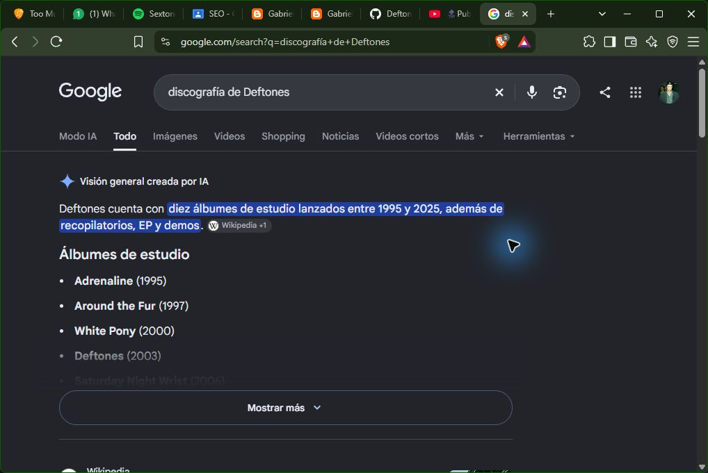

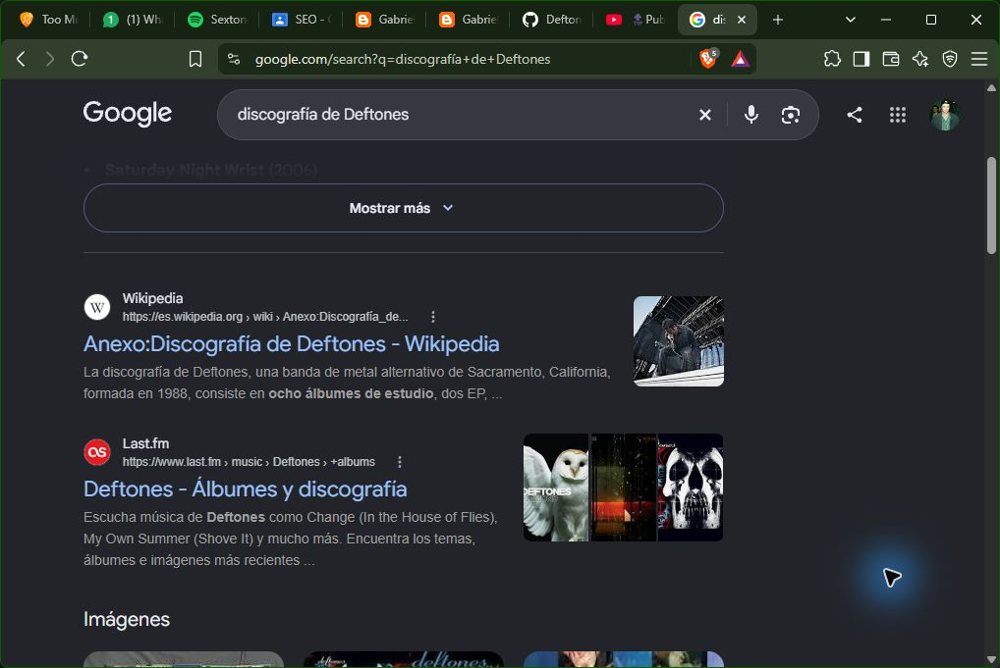

### Capturas de Ubersuggest

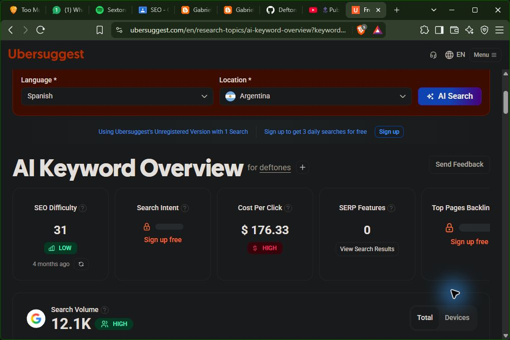

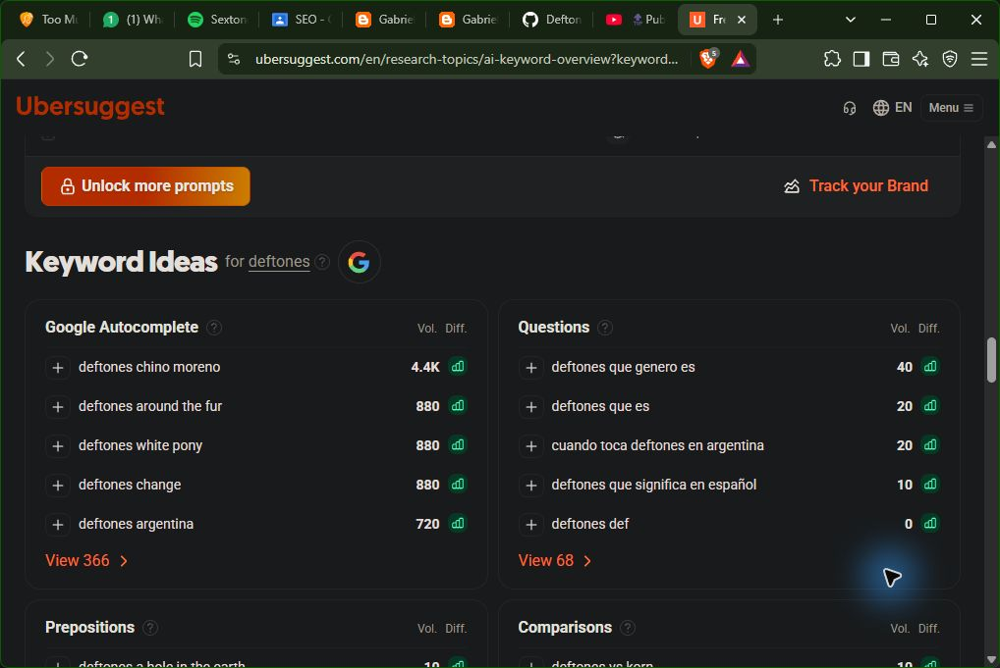

## 2. Optimización de las páginas

Actualicé los metadatos de las 14 páginas de `html/`. Cada una tiene un `<title>` único relacionado con el tema de la página, una descripción propia y una dirección canónica absoluta. El encabezado principal visible identifica el contenido de cada sección, y los encabezados secundarios organizan sus temas.

Ejemplo aplicado en Discografía:

```html
<title>Discografía de Deftones: álbumes y canciones</title>
<meta name="description" content="Recorré la discografía de Deftones, conocé sus álbumes de estudio y escuchá cada portada desde Spotify.">
<link rel="canonical" href="https://deftonesfansite.vercel.app/html/discografia.html">
```

Las imágenes del sitio cuentan con descripciones `alt`; la revisión encontró cero etiquetas `` sin ese atributo. En la Galería agregué `loading="lazy"` y `decoding="async"` para diferir las imágenes que aparecen más abajo y permitir su decodificación sin bloquear el hilo principal.

Las rutas actuales son legibles por sus nombres, por ejemplo `html/discografia.html` e `html/integrantes.html`. Se conserva la extensión `.html` porque es la estructura del proyecto; cambiar a rutas sin extensión requeriría configurar redirecciones y actualizar los enlaces internos.

## 3. Lighthouse y auditoría SEO

Ejecuté Lighthouse en Chrome DevTools sobre la página publicada y guardé la evidencia. En esa ejecución, la categoría **SEO obtuvo 100/100**. También comprobé metadatos, etiquetas `alt` y la declaración `viewport` en el código.

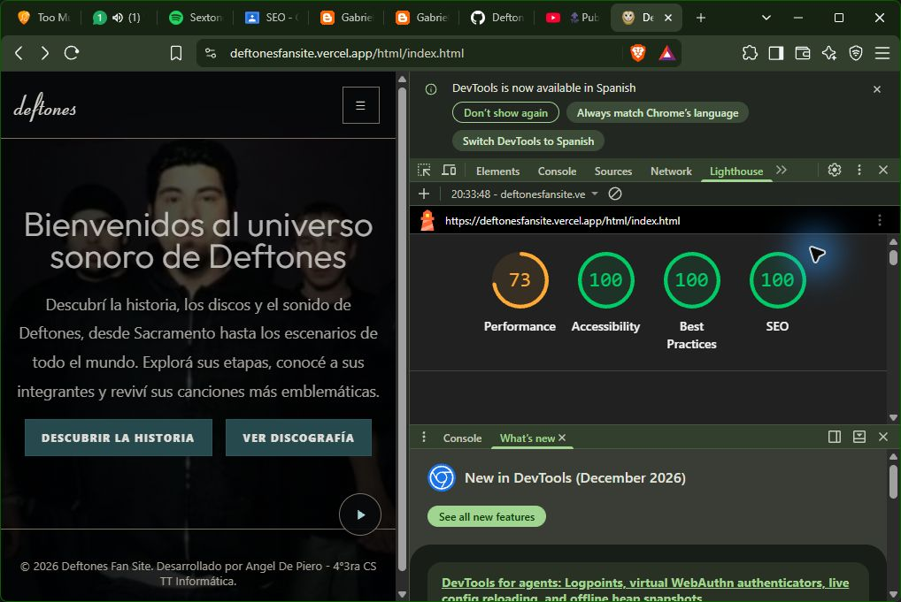

Una ejecución independiente de Lighthouse desde DevTools en emulación móvil registró **SEO 100**, **Accesibilidad 100**, **Buenas prácticas 100** y **Rendimiento 73**. En esa corrida, el LCP llegó a 31,6 s. Este dato difiere mucho de PageSpeed Insights, que en otra ejecución midió un LCP móvil de 1,5 s; las herramientas realizan pruebas de laboratorio separadas y los resultados pueden variar. Dejo ambas capturas para que la diferencia sea visible, en vez de ocultarla o presentar una sola como resultado universal.


## 4. Diseño adaptable y dispositivos

Probé la portada en los cinco tamaños solicitados mediante emulación de dispositivos en el navegador. Estas capturas permiten revisar el menú, la distribución del contenido y la composición del inicio. La prueba corresponde a la portada; no certifica cada página ni cada interacción del sitio.

| Dispositivo | Tamaño emulado | Observación en la portada |
|---|---:|---|
| iPhone 14 | 390 × 844 | Se usa el menú compacto y el contenido se adapta al ancho móvil. |
| Galaxy S23 | 360 × 780 | Se usa el menú compacto; el ancho disponible es menor y el contenido se apila. |
| iPad | 820 × 1180 | En este ancho todavía aparece el menú compacto; es un punto a revisar si se desea aprovechar mejor el espacio de tablet. |
| Laptop | 1366 × 768 | Se muestra la navegación amplia y la composición de escritorio. |
| Desktop | 1920 × 1080 | Se muestra la navegación amplia en un viewport grande. |

### Capturas responsivas

### iPhone 14 — 390 × 844

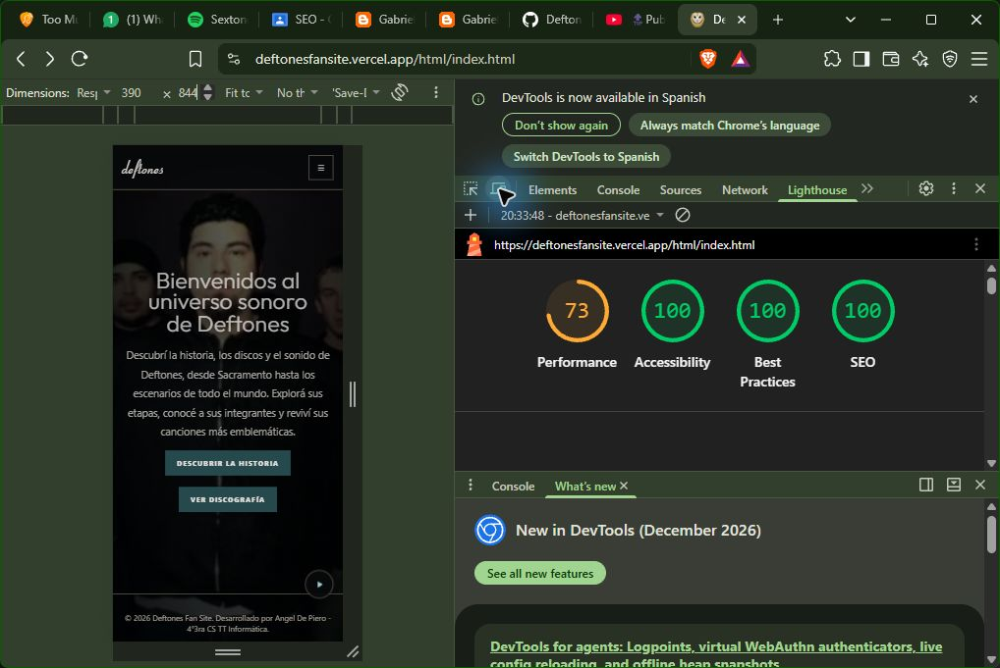

### Galaxy S23 — 360 × 780

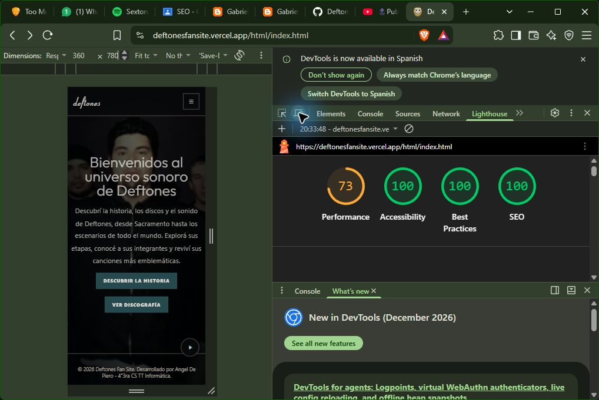

### iPad — 820 × 1180

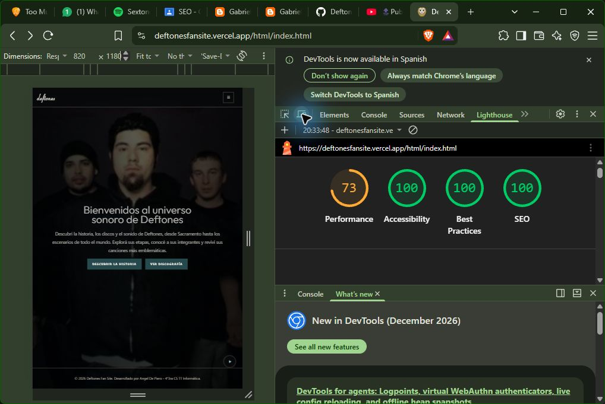

### Laptop — 1366 × 768

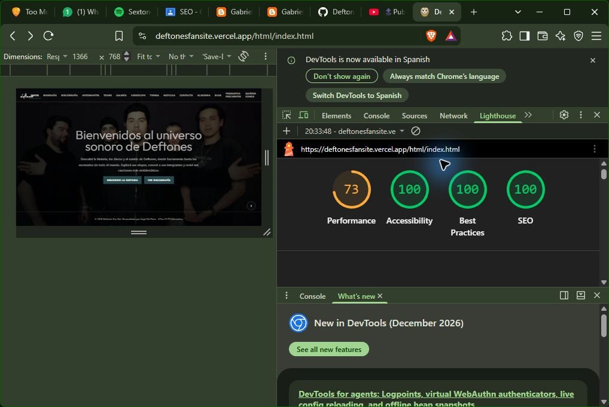

### Desktop — 1920 × 1080

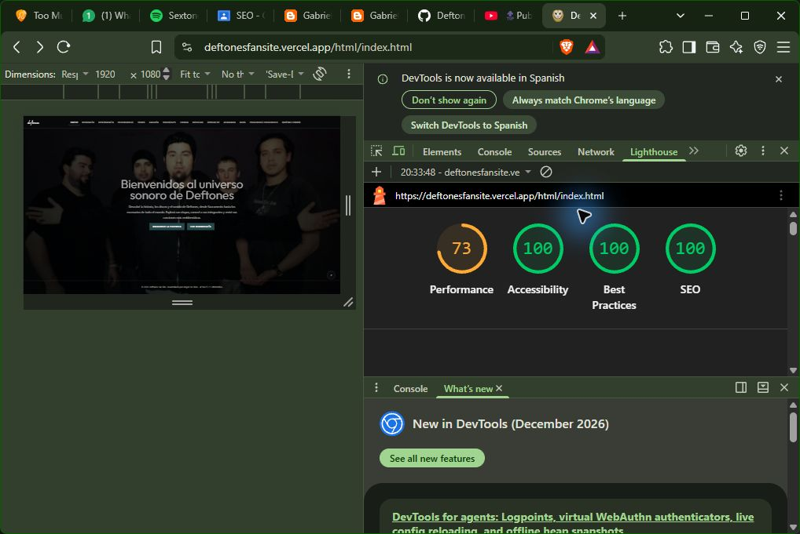

## 5. Velocidad y rendimiento

Medí la URL publicada con [PageSpeed Insights](https://pagespeed.web.dev/), tanto en móvil como en escritorio. Son resultados de laboratorio para una ejecución concreta; no había datos de campo de CrUX disponibles en esos informes al momento de la captura.

| Modo | Rendimiento | Accesibilidad | Buenas prácticas | SEO | FCP | LCP | TBT | CLS | Speed Index |
|---|---:|---:|---:|---:|---:|---:|---:|---:|---:|
| Móvil | 100 | 100 | 100 | 100 | 1,5 s | 1,5 s | 0 ms | 0 | 1,7 s |
| Escritorio | 77 | 100 | 100 | 100 | 0,5 s | 5,2 s | 0 ms | 0,002 | 0,7 s |

La prueba móvil emuló un Moto G Power con una conexión lenta simulada. El informe estimó un peso total de transferencia de unos **6.000 KiB**. En escritorio, el LCP de 5,2 s y la puntuación de rendimiento de 77 muestran que todavía conviene optimizar el elemento visual principal y reducir el peso de recursos. PageSpeed indicó oportunidades de ahorro por recursos que bloquean el renderizado, fuentes e imágenes. La portada utiliza una imagen de fondo grande, por lo que es un recurso prioritario para revisar.

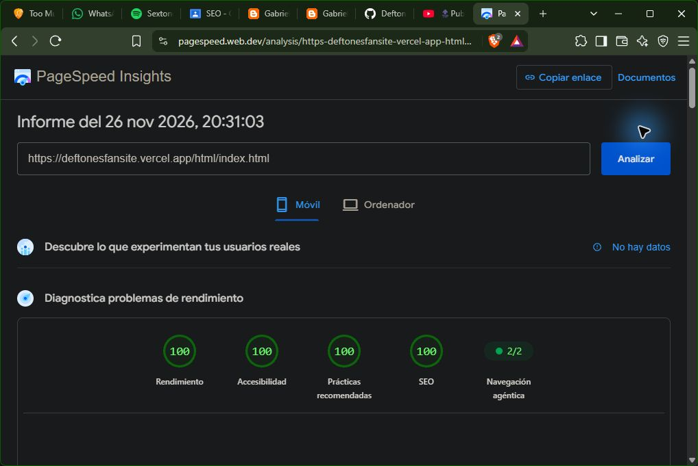

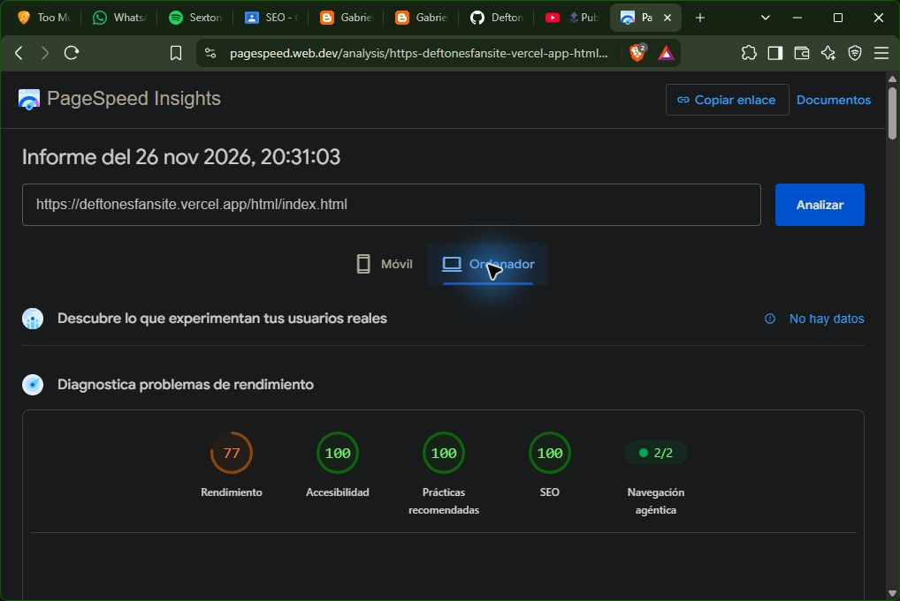

Las mediciones no son una garantía de la velocidad que tendrá cada visitante: pueden variar por dispositivo, red, caché y estado del servidor. La puntuación de escritorio más baja y el LCP elevado son los principales puntos de mejora encontrados en esta revisión.

## 6. Sitemap

Creé [`sitemap.xml`](../../sitemap.xml) en la raíz del proyecto. Enumera las 14 páginas públicas con URLs absolutas, fecha de modificación y frecuencia orientativa. Un sitemap facilita que Google y otros buscadores descubran las direcciones importantes; no obliga a indexarlas ni garantiza una posición en los resultados.

Los rastreadores lo utilizan para conocer esas URLs. Se ubica en la raíz, por lo que su dirección publicada es `https://deftonesfansite.vercel.app/sitemap.xml`. También se puede enviar desde el informe **Sitemaps** de Google Search Console una vez verificada la propiedad del sitio.

## 7. Archivo para rastreadores: `robots.txt`

La consigna lo llama “Robot.xml”, pero el nombre estándar reconocido por los buscadores es `robots.txt`; por eso creé [`robots.txt`](../../robots.txt) en la raíz.

```text
User-agent: *
Allow: /
Disallow: /api/
Disallow: /data/
Disallow: /Github%20subir%20y%20bajar/

Sitemap: https://deftonesfansite.vercel.app/sitemap.xml
```

- **`User-agent`** identifica a qué rastreador se aplica el grupo de reglas. `*` representa a todos.
- **`Disallow`** indica al robot que no rastree la ruta señalada. En este archivo evita recorrer rutas técnicas y datos que no son páginas públicas.
- **`Allow`** permite rastrear la ruta indicada; `Allow: /` deja accesible el contenido público.
- Si se usara `Disallow: /` para `User-agent: *`, se pediría a todos los rastreadores que no recorran ninguna ruta del sitio. No conviene hacerlo porque impediría descubrir el contenido. `robots.txt` regula rastreo; no garantiza que una URL desaparezca de los resultados.

## Fuentes

- [Google Search Central: crear y enviar un sitemap](https://developers.google.com/search/docs/crawling-indexing/sitemaps/build-sitemap).
- [Google Search Central: introducción a robots.txt](https://developers.google.com/search/docs/crawling-indexing/robots/intro).
- [Google Search Central: especificación de robots.txt](https://developers.google.com/crawling/docs/robots-txt/robots-txt-spec).
- [Ayuda oficial de Ubersuggest: investigación de palabras clave](https://help.ubersuggest.com/hc/en-us/articles/4418317806747-How-to-Get-Keyword-Ideas-Using-the-Keyword-Research).
- [Sitio del proyecto en Vercel](https://deftonesfansite.vercel.app/html/index.html).
- PageSpeed Insights: [informe móvil](https://pagespeed.web.dev/analysis/https-deftonesfansite-vercel-app-html-index-html/nq506fbr6kpmc0c5hhqccz?form_factor=mobile) y [informe escritorio](https://pagespeed.web.dev/analysis/https-deftonesfansite-vercel-app-html-index-html/nq506fbr6kpmc0c5hhqccz?form_factor=desktop).

## Evidencias

Las capturas de las búsquedas, auditoría, métricas y pruebas de viewport usadas en este informe están guardadas en [`capturas/`](capturas/). Los volúmenes y puntuaciones corresponden a las pantallas capturadas el **26 de noviembre de 2026**; las estimaciones de competencia que no tienen dificultad numérica de Ubersuggest están identificadas explícitamente como cualitativas.
