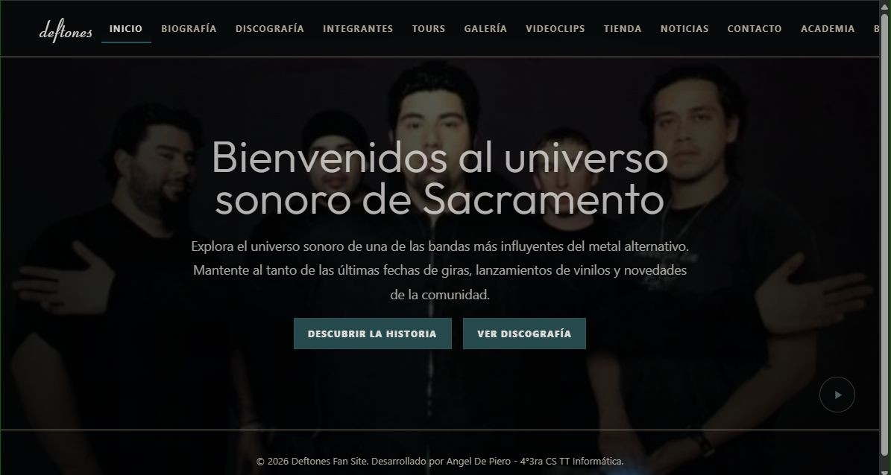

# TP HTML SEO — optimización del Deftones Fan Site

**Autor:** Angel De Piero  
**Curso:** 4°3ra CS TT Informática  
**Sitio publicado:** [deftonesfansite.vercel.app](https://deftonesfansite.vercel.app/html/index.html)

## Introducción

SEO reúne las mejoras que ayudan a los buscadores a encontrar, interpretar y presentar las páginas. Para este trabajo revisé el SEO on-page y técnico del sitio: títulos, descripciones, encabezados, textos alternativos, direcciones, adaptación a distintos anchos y archivos para rastreadores.

El marco teórico explica que Google descubre páginas mediante rastreo, las incorpora a su índice y luego decide cómo ordenarlas. Las mejoras de este trabajo facilitan ese proceso, pero no garantizan por sí solas que una página aparezca en los resultados.

## 1. Palabras clave e intención de búsqueda

Las búsquedas de Google muestran que los resultados para el nombre de la banda y su discografía incluyen el sitio oficial, enciclopedias musicales y plataformas de streaming. Por eso las palabras más generales tienen competencia orgánica alta; las consultas específicas de historia y análisis son más acotadas y compiten con menos páginas dedicadas a responderlas.

La siguiente tabla es una **estimación inicial por niveles** para orientar el trabajo, no un informe numérico exportado de Ubersuggest. Las herramientas presentan promedios mensuales que varían según país, idioma y período. Antes de entregar, conviene ingresar cada frase en Ubersuggest con ubicación **Argentina** y completar la cifra y la dificultad SEO que aparezcan allí. No presento esos datos como si los hubiera medido.

| Tipo | Palabra clave | Volumen aproximado | Competencia orgánica estimada | Intención |
|---|---|---:|---|---|
| Principal | Deftones | Alto; demanda amplia, cifra mensual pendiente de confirmar | Alta: aparecen fuentes oficiales, plataformas y sitios de música consolidados | Navegacional e informativa |
| Principal | discografía de Deftones | Medio | Media/alta: compite con bases de datos, servicios musicales y páginas especializadas | Informativa y navegacional |
| Principal | integrantes de Deftones | Bajo/medio | Media: consulta específica, con competencia de biografías y enciclopedias | Informativa |
| Cola larga | historia de Deftones en español | Bajo | Baja/media: frase más específica; busca una explicación en español | Informativa |
| Cola larga | análisis del sonido de Deftones | Bajo | Baja: consulta específica relacionada con la guía de estudio del sitio | Informativa |

### Evidencia de búsqueda

- [Buscar “Deftones” en Google](https://www.google.com/search?q=Deftones)
- [Buscar “discografía de Deftones” en Google](https://www.google.com/search?q=discograf%C3%ADa+de+Deftones)
- [Buscar “integrantes de Deftones” en Google](https://www.google.com/search?q=integrantes+de+Deftones)
- [Keyword Ideas de Ubersuggest](https://ubersuggest.com/en/research-topics/keyword-ideas)
- [Cómo interpreta Ubersuggest el volumen, la dificultad y la intención](https://help.ubersuggest.com/hc/en-us/articles/4418317806747-How-to-Get-Keyword-Ideas-Using-the-Keyword-Research)

**Capturas de Google y Ubersuggest:** quedan pendientes de adjuntar desde una búsqueda realizada con la ubicación Argentina. No se incluyen capturas simuladas ni cifras exactas sin una consulta real a la herramienta.

## 2. Optimización de las páginas

Actualicé los metadatos de las 14 páginas de `html/`. Cada una tiene un `<title>` único con el tema buscado, una descripción propia y una dirección canónica absoluta. El texto principal de cada página conserva un encabezado `<h2>` que describe su contenido; el encabezado `<h1>` existente identifica la marca Deftones en la cabecera común.

Ejemplo aplicado en Discografía:

```html
<title>Discografía de Deftones: álbumes y canciones</title>
<meta name="description" content="Recorré la discografía de Deftones, conocé sus álbumes de estudio y escuchá cada portada desde Spotify.">
<link rel="canonical" href="https://deftonesfansite.vercel.app/html/discografia.html">
```

Las imágenes del sitio ya cuentan con descripciones `alt`; la revisión encontró cero etiquetas `` sin ese atributo. En la Galería agregué `loading="lazy"` y `decoding="async"` para diferir las imágenes que están más abajo en la página y permitir su decodificación sin bloquear el hilo principal.

Las rutas actuales son legibles por su nombre, por ejemplo `html/discografia.html` y `html/integrantes.html`. Mantengo la extensión `.html` porque es la estructura que usa el proyecto; cambiar a rutas sin extensión requeriría configurar redirecciones en Vercel y actualizar los enlaces internos.

## 3. Lighthouse y auditoría SEO

La inspección del código permitió corregir los problemas SEO que se podían confirmar sin ejecutar Lighthouse: todas las páginas ahora tienen `<title>` y `meta description`, cada ruta tiene canonical y no se encontraron imágenes sin `alt`. El `viewport` ya está declarado en las páginas HTML.

**Puntaje Lighthouse:** no medido en esta edición. No adjunto un número inventado. Para completar la captura solicitada:

1. Abrir la página publicada en Chrome o Edge.
2. Abrir las herramientas del desarrollador con **F12**.
3. Elegir **Lighthouse**, marcar **SEO** y ejecutar el análisis.
4. Guardar una captura del puntaje y de las recomendaciones que queden.
5. Repetir para la portada y, si se desea, para Discografía.

La página inicial del proyecto es `https://deftonesfansite.vercel.app/html/index.html`.

## 4. Diseño adaptable y dispositivos

La hoja `css/style.css` usa puntos de adaptación a 1050, 760 y 420 píxeles. El menú se convierte en desplegable en pantallas menores a 1050 px; la grilla de álbumes pasa a dos columnas en ese ancho, los videoclips e integrantes se apilan por debajo de 760 px y los álbumes usan una columna por debajo de 420 px. Ajusté el punto de 1050 px a dos columnas para que las portadas no queden angostas en tablet.

La tabla describe el comportamiento previsto por las reglas CSS. **No equivale a una prueba visual en el emulador del navegador**; hay que ejecutar esas vistas y agregar sus capturas antes de presentar el trabajo.

| Dispositivo de la consigna | Tamaño de referencia | Comportamiento previsto | Estado de captura |
|---|---:|---|---|
| iPhone 14 | 390 × 844 | Menú compacto; álbumes en una columna; contenido apilado | Pendiente de prueba visual |
| Galaxy S23 | 360 × 780 | Menú compacto; álbumes en una columna; contenido apilado | Pendiente de prueba visual |
| iPad | 820 × 1180 | Menú compacto; álbumes en dos columnas | Pendiente de prueba visual |
| Laptop | 1366 × 768 | Navegación amplia; grilla de escritorio | Pendiente de prueba visual |
| Desktop | 1920 × 1080 | Navegación y grillas en su distribución amplia | Pendiente de prueba visual |

El proyecto ya cuenta con capturas de escritorio de la edición visual anterior. Se incluyen solo como referencia del aspecto de las páginas; no representan resultados de una prueba en cada dispositivo:




## 5. Velocidad y rendimiento

No se obtuvo una medición de Lighthouse ni de PageSpeed en esta edición, así que no informo puntajes, LCP ni otras métricas como si fueran resultados medidos. La revisión estática sí permitió aplicar carga diferida a la Galería. Otros recursos que conviene medir en PageSpeed Insights son la imagen de fondo de Inicio, las portadas y los archivos de video, porque pueden afectar el tiempo de carga y el peso transferido.

Para agregar la evidencia, ejecutar [PageSpeed Insights](https://pagespeed.web.dev/) con la URL publicada, primero en móvil y después en escritorio, y guardar las dos capturas. En Lighthouse revisar especialmente rendimiento, oportunidades para optimizar imágenes y recursos que bloqueen el renderizado.

## 6. Sitemap

Creé [`sitemap.xml`](../../sitemap.xml) en la raíz del proyecto. Enumera las 14 páginas públicas con URLs absolutas, fecha de modificación y frecuencia orientativa. Un sitemap le facilita a Google y a otros buscadores descubrir las direcciones importantes; no obliga a indexarlas ni garantiza una posición en los resultados.

Los rastreadores lo utilizan para conocer esas URLs. Se ubica en la raíz para que la dirección publicada sea `https://deftonesfansite.vercel.app/sitemap.xml`. También se puede presentar en Google Search Console desde el informe **Sitemaps**, una vez que la propiedad del sitio esté verificada.

## 7. Archivo para rastreadores: `robots.txt`

La consigna lo llama “Robot.xml”, pero el nombre estándar reconocido por los buscadores es `robots.txt`; por eso creé [`robots.txt`](../../robots.txt) en la raíz. Controla qué rutas pueden solicitar los rastreadores, y además les indica dónde está el sitemap.

```text
User-agent: *
Allow: /
Disallow: /api/
Disallow: /data/
Disallow: /Github%20subir%20y%20bajar/

Sitemap: https://deftonesfansite.vercel.app/sitemap.xml
```

- **`User-agent`** identifica a qué rastreador se aplica el grupo de reglas. `*` representa a todos.
- **`Disallow`** pide al robot que no rastree la ruta indicada. En este archivo evita recorrer rutas técnicas y datos que no son páginas públicas del sitio.
- **`Allow`** permite rastrear la ruta indicada; `Allow: /` deja accesible el contenido público.
- Si se usara `Disallow: /` para `User-agent: *`, se pediría a todos los rastreadores que no rastreen ninguna ruta del sitio. No conviene hacerlo porque impediría descubrir el contenido. `robots.txt` regula rastreo; no es un mecanismo para garantizar que una URL desaparezca de los resultados.

## Estado de las evidencias solicitadas

| Evidencia | Estado |
|---|---|
| Capturas de resultados de Google y métricas de Ubersuggest | Pendientes; falta guardar capturas de las búsquedas con ubicación Argentina y completar cifras reales. |
| Capturas de Lighthouse SEO | Pendientes de ejecutar en el navegador. |
| Capturas responsivas para los cinco dispositivos | Pendientes de probar en emulación de dispositivos. |
| Capturas y métricas de rendimiento | Pendientes de ejecutar en PageSpeed Insights o Lighthouse. |
| Metadatos, `sitemap.xml`, `robots.txt` y revisión de `alt` | Aplicados en el proyecto local. |

## Fuentes

- [Google Search Central: crear y enviar un sitemap](https://developers.google.com/search/docs/crawling-indexing/sitemaps/build-sitemap).
- [Google Search Central: introducción a robots.txt](https://developers.google.com/search/docs/crawling-indexing/robots/intro).
- [Google Search Central: interpretación de robots.txt](https://developers.google.com/crawling/docs/robots-txt/robots-txt-spec).
- [Ayuda oficial de Ubersuggest: investigación de palabras clave](https://help.ubersuggest.com/hc/en-us/articles/4418317806747-How-to-Get-Keyword-Ideas-Using-the-Keyword-Research).
- [Sitio del proyecto en Vercel](https://deftonesfansite.vercel.app/html/index.html).
